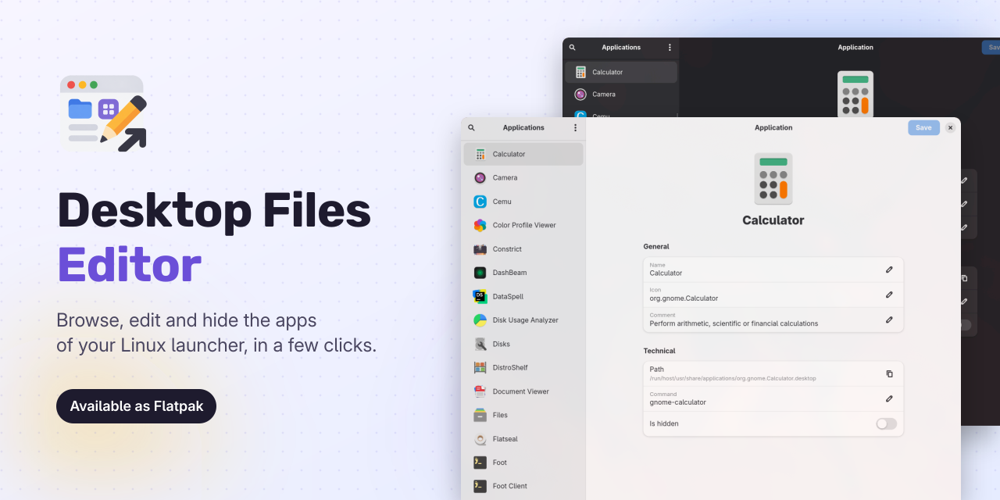

<div align="center">


<p align="center">
  
</p>

# Desktop Files Editor



</div>

Desktop Files Editor lists every app of your Linux launcher and lets you edit its
.desktop file in a clean GTK4/libadwaita interface. No more hunting for files across
folders.

## Installation

Download `desktop-files-editor.flatpak` from the
[latest release](https://github.com/MathieuMarthy/desktop-files-editor/releases/latest),
then install it:

```sh
flatpak install --user desktop-files-editor.flatpak
flatpak run net.dzqdzq.DesktopFilesEditor
```

The app relies on the GNOME runtime from [Flathub](https://flathub.org/setup).
If Flathub is not set up yet:

```sh
flatpak remote-add --user --if-not-exists flathub https://dl.flathub.org/repo/flathub.flatpakrepo
```

## Development

### Requirements

Install these with your distribution's package manager:

- `flatpak` and `flatpak-builder`: build and run the app
- [`uv`](https://docs.astral.sh/uv/): Python development environment
- `gtk4` and `libadwaita`: needed by the tests and by editor autocompletion
- `meson`, `blueprint-compiler` and `gettext`: data tests, formatting and translations

The app itself has no Python dependency to install: GTK, Libadwaita and PyGObject
come from the GNOME runtime declared in the Flatpak manifest.

### Setup

```sh
uv sync            # creates .venv with pytest, ruff and the PyGObject stubs
meson setup build  # only needed for `meson test` and translations
```

In your editor, select `.venv/bin/python` as the Python interpreter.

### Build and run

```sh
flatpak-builder --force-clean --user --install --install-deps-from=flathub \
    build-dir net.dzqdzq.DesktopFilesEditor.json
flatpak run net.dzqdzq.DesktopFilesEditor
```

### Tests

```sh
uv run pytest        # Python code
meson test -C build  # desktop file, metainfo and settings schema
```

### Format

```sh
uv run ruff check --fix src tests          # Python lint
uv run ruff format src tests               # Python format
blueprint-compiler format -f src/**/*.blp  # Blueprint
meson format -i -r                         # Meson
```

### Translations

See [po/README.md](po/README.md).

## Contributing

PRs are welcome!

Make sure the tests pass and the code is formatted before opening one.

## License

[GPL-3.0-or-later](COPYING)
